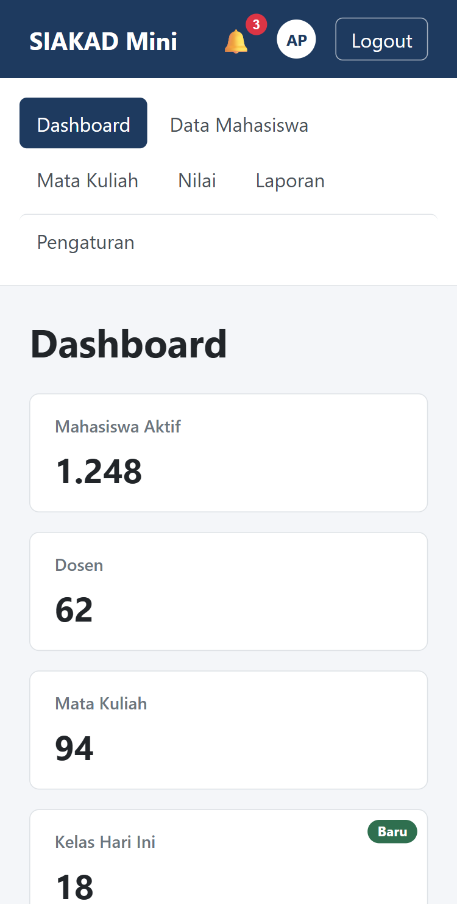

# Laporan Praktikum Pertemuan 5 — Pemrograman Web 1

Nama  : Ahmad Hafi Badali
NIM   : 2510010101
Kelas : 3B REG BJB PAGI

## Percobaan 1 — Box Model

| No | Kondisi | Lebar Kotak A (px) | Lebar Kotak B (px) |
|----|---------|--------------------|--------------------|
| 1 | padding 20px | 350 | 300 |
| 2 | padding 40px | 390 | 300 |

| No | Kondisi | Jarak judul–paragraf (px) |
|----|---------|---------------------------|
| 3 | Block biasa | 30 |
| 4 | Di dalam flex column | 50 |

| No | Kondisi `.menu a` | Latar menimpa teks lain? (ya/tidak) |
|----|-------------------|-------------------------------------|
| 5 | inline (bawaan) | ya |
| 6 | inline-block | tidak |

## Percobaan 2 — Flexbox Lab

| No | Properti dan nilai | Pengamatan |
|----|--------------------|------------|
| 1 | `display: flex` | Sebelumnya ketiga item bertumpuk ke bawah selebar penuh. Setelah `display: flex`, item berjajar horizontal dan sama tinggi (240 px) karena `align-items: stretch` bawaan. |
| 2 | `justify-content: space-between` | A menempel di kiri, C di kanan, dan B berada di tengah ruang sisa. Celah hanya ada di antara item. |
| 2 | `justify-content: space-evenly` | Semua celah, termasuk di tepi kiri dan kanan container, sama besar. |
| 3 | `align-items: stretch` vs `center` | `stretch` membuat item setinggi container. `center` membuat item setinggi isinya dan berada di tengah secara vertikal. |
| 4 | `flex-direction: column` + `justify-content: center` | Item tersusun vertikal dan terkumpul di tengah secara vertikal. Main axis berubah menjadi vertikal, sehingga `justify-content` mengatur atas–bawah. |
| 5 | 8 item × 200 px, nowrap vs wrap | Dengan nowrap, delapan item dipaksa muat dan menyusut (flex-shrink 1). Dengan wrap, item tetap 200 px dan turun ke baris berikutnya. |
| 6 | `.b { flex-grow: 1 }` | B mengambil seluruh ruang sisa, sedangkan A dan C tetap selebar isinya. |
| 7 | Lebar A / B / C (px) | A = 200, B ≈ 266,7, C ≈ 533,3 (sisa 800 px dibagi 1 : 2). |
| 8 | `.c { order: -1 }` | C tampil paling kiri, tetapi urutan di HTML tidak berubah (urutan baca pembaca layar juga sama). |
| 9 | `.c { margin-left: auto }` | C terdorong ke ujung kanan, A dan B tetap di kiri, karena margin otomatis menyerap seluruh ruang sisa. |
| 10 | `gap: 24px` | Muncul jarak 24 px di antara item, tanpa jarak di tepi container. |

## Percobaan 3 — Positioning

| No | Eksperimen | Pengamatan |
|----|------------|------------|
| 1 | Header sticky saat digulir | Header ikut mengalir di atas halaman, lalu menempel di tepi atas saat digulir. Paragraf pertama tidak tertutup. Tombol Bantuan (fixed) selalu tetap di pojok kanan bawah. |
| 2a | Header fixed tanpa padding-top body | Header keluar dari aliran dokumen, sehingga judul h1 dan paragraf pertama tertutup header. |
| 2b | Header fixed dengan padding-top 64px | Konten bergeser turun sejauh tinggi header dan kembali terlihat. |
| 3 | `.notif` tanpa `position: relative` | Badge berpindah ke pojok kanan atas header, bukan lagi di lonceng. Badge mencari leluhur terdekat yang bukan static, dan di sini header (sticky) yang jadi acuan. |
| 4 | `.lapis-1` z-index 3, lalu `.lapis-2` z-index 5 | Tanpa z-index, Lapis 3 (ditulis terakhir) paling depan. Dengan z-index 3, Lapis 1 maju ke depan. Setelah Lapis 2 diberi 5, Lapis 2 paling depan. |
| 5 | Header z-index 1 | Saat digulir, Lapis 1 (z-index 3) dan Lapis 2 (z-index 5) menutupi header. Karena itu perlu skala z-index yang konsisten (konten 0, navbar 100, modal 1000). |
| 6 | Tombol Bantuan di layar 375 px | Tombol tetap di pojok kanan bawah viewport saat digulir, karena `position: fixed` mengacu ke viewport. |

## Percobaan 4 — Dashboard

## Jawaban Pertanyaan Analisis

1. Dengan `content-box`, `width` hanya mengukur area konten, sehingga padding dan border menambah ukuran total. Pada Percobaan 1, Kotak A yang ditulis 300 px tampil 350 px (300 + 2×20 + 2×5) dan jadi 390 px saat padding 40. Dengan `border-box`, lebar total tetap 300 px dan yang menyusut adalah area konten. Karena itu aturan ini ditulis di awal agar ukuran elemen mudah diprediksi dan tidak meluap, misalnya sidebar tetap tepat 240 px.

2. Pada `flex-direction: row` main axis horizontal dan cross axis vertikal. Setelah diubah ke `column`, kedua sumbu bertukar: main axis menjadi vertikal dan cross axis horizontal. `justify-content` selalu bekerja di main axis, sehingga `justify-content: center` memusatkan item secara vertikal (atas–bawah).

3. Ruang container 1000 px. A memakai `flex: 0 0 200px`, sehingga sisa ruang = 1000 − 200 = 800 px. `flex: 1` berarti basis 0% dengan grow 1, dan `flex: 2` berarti grow 2, jadi sisa 800 px dibagi 1 : 2. B = 800 × 1/3 ≈ 266,7 px dan C = 800 × 2/3 ≈ 533,3 px. Jika `.b` diberi `flex: 1 1 auto`, basis B menjadi lebar isi teksnya, bukan 0. Ruang sisa yang dibagi jadi lebih kecil dan B = lebar isi + 1/3 sisa. Akibatnya B lebih lebar dari 266,7 px, C lebih sempit dari 533,3 px, dan perbandingan akhir tidak lagi tepat 1 : 2.

4. `position: absolute` mengacu pada leluhur terdekat yang `position`-nya bukan static. Saat `position: relative` pada `.notif` dihapus, tombol lonceng tidak lagi menjadi acuan. Leluhur terdekat berikutnya yang di-position adalah header (sticky), sehingga badge menempel di pojok kanan atas header.

5. `sticky` tetap ikut aliran dokumen, sehingga ruangnya tetap terpakai dan konten tidak tertutup, lalu menempel di atas saat digulir. `fixed` keluar dari aliran, sehingga konten di bawahnya tertutup kecuali body diberi `padding-top` setinggi navbar. Untuk navbar dashboard saya memilih `sticky`, karena tidak perlu mengatur padding manual dan tinggi navbar tidak perlu disalin ke tempat lain. Syaratnya, tidak ada leluhur dengan `overflow: hidden` dan `top: 0` harus ditulis.

6. `.wrapper` berada di dalam `body` yang `display: flex` dengan arah column dan `min-height: 100vh`. `flex: 1` membuat `.wrapper` mengambil seluruh sisa tinggi di antara navbar dan footer. Akibatnya footer terdorong ke dasar layar. Jika baris itu dihapus, `.wrapper` hanya setinggi isinya, sehingga pada konten sedikit footer naik ke tengah layar.

## Kesimpulan

Dari praktikum ini saya belajar bahwa `box-sizing: border-box` membuat ukuran elemen lebih mudah diperkirakan, dan bahwa Flexbox bekerja berdasarkan main axis dan cross axis. Saya juga memahami perbedaan `sticky`, `fixed`, dan `absolute`, termasuk peran `position: relative` sebagai titik acuan dan peran z-index pada tumpukan elemen. Dengan kombinasi ketiganya, dashboard SIAKAD Mini bisa dibuat rapi dan responsif hanya dengan CSS murni. Kendala yang saya temui adalah menghitung lebar item pada `flex: 1` dan `flex: 2`, serta memastikan footer tetap di dasar layar.
